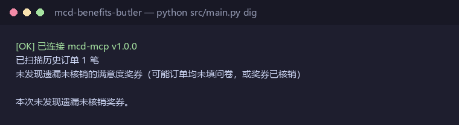
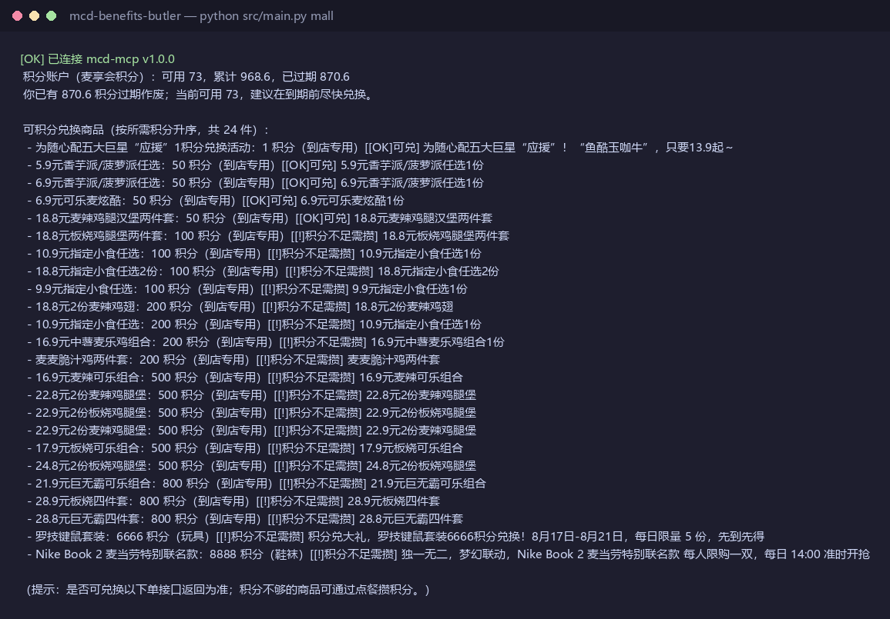
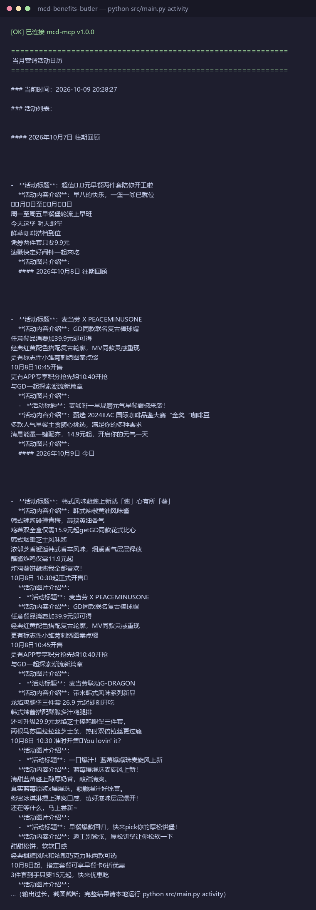

# 麦麦权益管家 · McDonald's Benefits Butler

> 一个基于**麦当劳官方 MCP 能力**（`mcd-mcp-server`）的 WorkBuddy Skill / 开源工具，帮你把散落在各处的麦当劳权益一次性盘活。

---

## 🎯 它解决什么

你在麦当劳 APP 里其实拥有不少"权益"，但它们散落在不同入口、还常被遗忘：

- 点完餐忘了填满意度问卷 → **关联奖券白白过期**
- 攒了一堆积分，却不知道换什么最值、还快过期了
- 每周都有抽奖 / 领券 / 限定活动，但记不住哪天有啥

麦麦权益管家用**官方 MCP 工具**自动把这些权益挖出来、算清楚、排好日历——只做一件事：**让你的麦当劳权益不再漏、不再废**。

---

## ✨ 三大能力

### 1. 满意度奖券挖宝 🕵️（最强记忆点）
扫描你的历史订单，逐单查询"点完没填问卷"的关联奖券，把**你可能漏领的免费券**一次性列出来。

> 传播钩子："你竟漏了 X 张免费堡"——这类"找回被遗忘权益"的惊喜感，最容易跨圈传播。

### 2. 积分商城精算 💎（蓝海）
读取你的积分账户，结合积分商城商品，推荐**性价比最高的兑换组合**，并支持一键下单，专治"积分焦虑"（不知换啥、快过期）。

### 3. 活动 / 抽奖日历聚合 📅（蓝海）
聚合当月营销活动、积分抽奖（如麦金喜积分霸王餐）、麦麦省可领券，告诉你**本周哪天有啥优惠 / 抽奖，一键参与**。

---

## 🚀 快速开始

```bash
# 1. 配置 Token（仅环境变量，绝不入库）
export MCD_MCP_TOKEN="你的麦当劳MCP Token"   # 申请地址：https://open.mcd.cn/mcp

# 2. 安装依赖
pip install -r requirements.txt

# 3. 运行示例 CLI
python src/main.py dig        # 满意度奖券挖宝
python src/main.py mall        # 积分商城导购
python src/main.py activity    # 活动 / 抽奖日历聚合
```

**WorkBuddy 用户**：将本仓库作为 Skill 接入（见 `SKILL.md`），MCP 配置参考 `mcp-config.example.json`，在连接器页对 `mcd-mcp` 点「信任」启用。

---

## 📸 演示截图（真实运行输出）
- 
- 
- 

---

## 🧩 架构

```
用户输入
   │
   ▼
main.py（命令行路由）
   │
   ▼
mcd_mcp_client.py（MCP Streamable HTTP 封装：initialize + tools/call + session）
   │
   ├─ dig_coupons.py      （满意度奖券挖宝）
   ├─ mall_advisor.py     （积分商城导购）
   └─ activity_hub.py     （活动 / 抽奖日历聚合）
   │
   ▼
mcd-mcp-server（麦当劳官方，35 个工具，本 Skill 使用其中 8+ 个）
```

各子模块与官方工具的映射、调用流程、业务价值，详见 [`MCP_INTEGRATION.md`](./MCP_INTEGRATION.md)。

---

## ⚠️ 声明

本项目为「麦当劳程序员节创意开发大赛」参赛作品，由参赛者独立开发，**非麦当劳官方产品**。项目输出仅供参考，不构成医疗、营养或其他专业建议；餐品信息、价格及供应状态以麦当劳官方渠道的实时结果为准。详见 [`CONTEST_DECLARATION.md`](./CONTEST_DECLARATION.md)。

---

## 🏆 参赛信息

- 赛事：麦当劳程序员节创意开发大赛
- 基础能力：[`mcd-mcp-server`](https://github.com/M-China/mcd-mcp-server)（麦当劳中国官方远程 MCP）
- 形式：开源 Skill，按 GitHub 公开 Star 排名领奖
