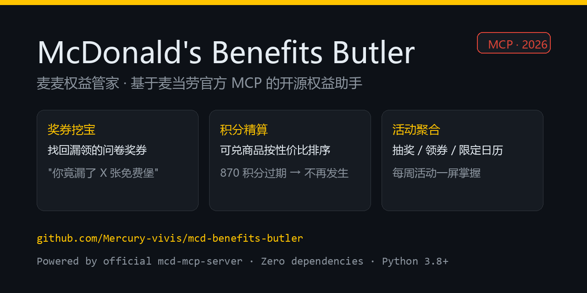

# 小白安装指南 · 麦麦权益管家

> 本指南面向**完全不懂代码**的朋友。你会用手机、会用鼠标就行。
> 项目是 [麦当劳程序员节创意开发大赛](https://github.com/M-China/mcd-developer-innovation-challenge) 的参赛作品，**非麦当劳官方产品**。

---

## 先选一条路

| 你的情况 | 推荐路径 | 难度 | 要装的东西 |
|---|---|---|---|
| 不想碰代码、只想马上用 | **路径 A：WorkBuddy 零安装** | ⭐ 零门槛 | 无（手机/电脑装个 WorkBuddy） |
| 想在自己电脑上本地跑、或想改代码 | 路径 B：本地运行 | ⭐⭐⭐ 需装 Python | Python 3.8+ |

下面两条路分开讲，挑你合适的看。

---

## 路径 A：WorkBuddy 零安装（最省事，强烈推荐）

**一句话**：不用装 Python、不用配环境变量，打开 WorkBuddy 点几下就能用。

### 步骤

1. **装 WorkBuddy**（如果还没有）。它就是个 AI 助手，官网下载安装即可。
2. 打开 WorkBuddy，进入左侧 **「连接器」** 页面，找到 **mcd-mcp**（麦当劳官方 MCP 服务）。
3. 点 **「信任」** 启用，按提示填入你的 **麦当劳 MCP Token**。
   - Token 申请地址：<https://open.mcd.cn/mcp>
   - 没有 Token 就先用不了，这是麦当劳官方要求的身份凭证。
4. 把本仓库作为 **Skill** 接入（参考仓库里的 `SKILL.md`），或者直接对 WorkBuddy 说一句话，比如：
   > "用麦麦权益管家帮我挖一下漏领的满意度奖券"

剩下的命令行、Token 管理、调用麦当劳官方工具，**WorkBuddy 全自动帮你跑**，你只管看结果。



---

## 路径 B：本地运行（需要一点点动手能力）

### B1. 装 Python

1. 打开 <https://www.python.org/downloads/>，下载最新版（3.8 以上都行）。
2. 安装时**务必勾选 `Add Python to PATH`**（最关键的一步，不然命令行找不到 Python）。
3. 验证：打开「命令提示符」(cmd)，输入 `python --version`，能显示版本号就成功了。

### B2. 拿到项目代码

- 最简单：到 GitHub 仓库页面点 **Code → Download ZIP**，解压到你喜欢的文件夹。
- 会 git 的：`git clone <你的仓库地址>`。

### B3. 配置 Token（只做一次）

Token 是麦当劳官方要的身份凭证，**只放在环境变量里，绝不写进代码或上传**。

- **Windows（命令提示符 cmd）**，先设好再跑：
  ```bat
  set MCD_MCP_TOKEN=你的Token
  python src/main.py dig
  ```
- **Windows（PowerShell）**：
  ```powershell
  $env:MCD_MCP_TOKEN="你的Token"
  python src/main.py dig
  ```
- **macOS / Linux（终端）**：
  ```bash
  export MCD_MCP_TOKEN="你的Token"
  python src/main.py dig
  ```
- Token 申请：<https://open.mcd.cn/mcp>

> 💡 嫌每次设环境变量麻烦？直接**双击 `run.bat`**（Windows），向导会让你粘贴一次 Token，仅本次运行有效，关掉窗口就消失，安全省心。

### B4. 运行

**方式一 · 双击（最傻瓜）**：直接双击项目根目录的 `run.bat`，按菜单数字选功能即可。

**方式二 · 命令行**：在解压目录下执行
```bash
python src/main.py dig        # 满意度奖券挖宝（查漏领的免费券）
python src/main.py mall       # 积分商城导购（查积分 + 推荐兑换）
python src/main.py activity   # 活动 / 抽奖日历聚合
# 下面两个会动你的账户，谨慎：
python src/main.py draw       # 执行一次积分抽奖（⚠️ 消耗积分）
python src/main.py claim      # 一键领取全部麦麦省券
```

### 真实运行效果

**满意度奖券挖宝**——把你点完餐忘了填问卷、关联奖券快过期的，一次性翻出来：


**积分商城导购**——读你的积分，推荐最值的兑换，并标出哪些快过期：


**活动 / 抽奖日历**——本周哪天有啥优惠、抽奖，一屏看清：


---

## 常见问题

**Q：提示 `python` 不是内部或外部命令？**
A：Python 没装，或装的时候没勾 `Add Python to PATH`。回到 B1 重装并勾选。

**Q：提示鉴权失败 / 401？**
A：Token 不对或过期。去 <https://open.mcd.cn/mcp> 重新申请，再按 B3 配置。

**Q：Token 会不会被上传泄露？**
A：不会。本项目**零依赖、纯本地运行**，Token 只在你本机内存/环境变量里，代码里没有任何地方写文件存 Token，也绝不入库（见 `.gitignore`）。

**Q：抽奖 / 领券会扣我的钱吗？**
A：不会扣钱，但 `draw` 会消耗你的**积分**，`claim` 是领券。两者都会动你的账户，按需使用。

**Q：我是 Mac / 手机，能用吗？**
A：本地运行需要电脑装 Python；手机用户直接走 **路径 A（WorkBuddy）** 最方便。
